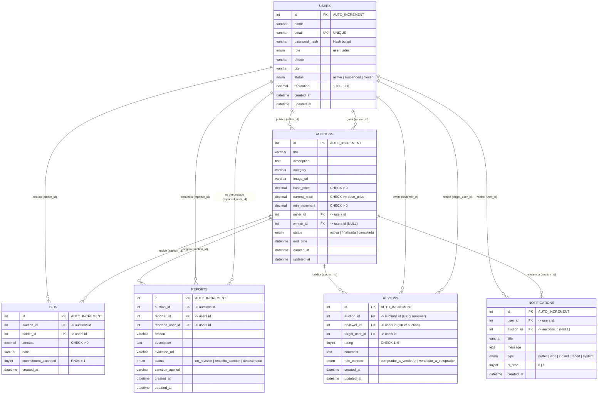

# Diagrama Entidad–Relación (DER) — BidZone (MySQL)

Modelo relacional diseñado en **Tercera Forma Normal (3FN)** con **6 tablas vinculadas** (superando el mínimo obligatorio de 5 tablas), claves primarias (`PK`), claves foráneas (`FK`), restricciones de dominio (`CHECK`, `ENUM`) y reglas de integridad referencial (`CASCADE`, `RESTRICT`, `SET NULL`).

## Diagrama Visual (Mermaid)

## Diccionario de Relaciones y Reglas de Integridad

| Relación | Cardinalidad | Clave Foránea | Acción Referencial | Regla de Negocio Asociada |
| :--- | :---: | :--- | :--- | :--- |
| `users` → `auctions` (vendedor) | `1 : N` | `auctions.seller_id` | `ON DELETE RESTRICT` | Identifica al dueño del lote; bloquea auto-pujas (**RN02**). |
| `users` → `auctions` (ganador) | `1 : N` | `auctions.winner_id` | `ON DELETE SET NULL` | Libera datos de contacto mutuos al cierre (**RN05**). |
| `auctions` → `bids` | `1 : N` | `bids.auction_id` | `ON DELETE CASCADE` | Historial cronológico de pujas en sala (**RN01**, **RN03**). |
| `users` → `bids` | `1 : N` | `bids.bidder_id` | `ON DELETE RESTRICT` | Compromiso vinculante e irrevocable del postor (**RN04**). |
| `auctions` → `reports` | `1 : N` | `reports.auction_id` | `ON DELETE CASCADE` | Vincula la denuncia a una operación específica. |
| `users` → `reports` | `1 : N` | `reporter_id`, `reported_user_id` | `ON DELETE RESTRICT` | Impide autodenuncia (`CHECK reporter_id <> reported_user_id`) y gestiona sanciones (**RN06**). |
| `auctions` → `reviews` | `1 : N` | `reviews.auction_id` | `ON DELETE CASCADE` | Restringe a una calificación por usuario y subasta con `UNIQUE (auction_id, reviewer_id)` (**RN07**). |
| `users` → `reviews` | `1 : N` | `reviewer_id`, `target_user_id` | `ON DELETE RESTRICT` | Escala de 1 a 5 estrellas (`CHECK rating BETWEEN 1 AND 5`) que recalcula `users.reputation`. |
| `users` → `notifications` | `1 : N` | `notifications.user_id` | `ON DELETE CASCADE` | Bandeja de alertas de sobrepuja, adjudicación y reportes. |

